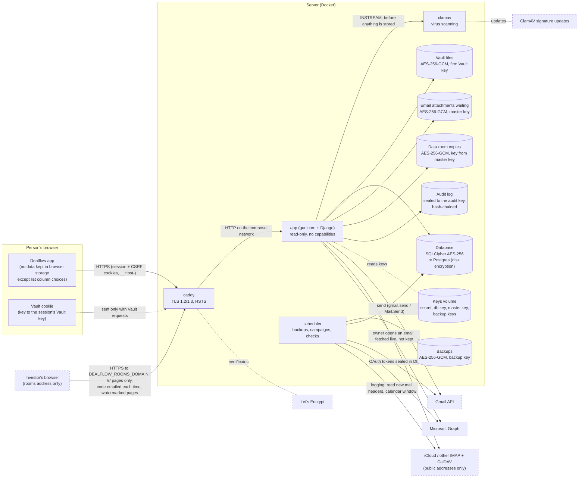

# Data flow

Where data goes and where it is encrypted (decision 63). Solid boxes are containers from
`docker-compose.yml`; dashed are outside services the firm chooses to connect.

| Data | At rest | In transit | Who can read it |
|---|---|---|---|
| Records (investors, contacts, outreach, deals, tasks) | SQLCipher (SQLite) with `db.key`; Postgres: disk/managed encryption | HTTPS | People whose role can view the module and field; restricted deals only their team |
| Vault files | AES-256-GCM per file, firm Vault key sealed to each person's PIN-derived key | HTTPS, `no-store` | People with Vault access and an open Vault (PIN) |
| Uploads in flight | Memory-only `/tmp` until scanned and encrypted | HTTPS | Nobody else |
| Email attachments waiting to send | AES-256-GCM with a key from `master.key` | HTTPS to Google/Microsoft | The sender (and the scheduler for campaigns) |
| Mailbox tokens, app passwords (logging), authenticator secrets | Sealed with a key from the Django secret | — | The app only |
| Logged emails and meetings | Subject, time, participants and attachment names in the database; the email text, meeting notes and attachments are never copied | TLS to the provider (certificates verified, IMAP/CalDAV only to public addresses) | Subject etc.: anyone who can see the record (hidden for restricted deals, addresses hidden by field access); text: only the mailbox owner, fetched live |
| Data room files | A copy of each shared Vault document, AES-256-GCM with a key from `master.key` (readable by the server without a PIN, to watermark it) | HTTPS; view-only files leave only as watermarked page pictures, downloads watermarked and traced | Investors with a working link and a fresh emailed code (after the NDA); people who can see the deal see titles and activity |
| Data room links, codes, investor sessions | Link: SHA-256 only, plus a copy sealed with a key from `master.key`; codes: HMAC-SHA256 with their own key; sessions: SHA-256 of a random cookie | Link by email from the banker's mailbox; codes by SMTP (TLS) or the banker's mailbox | Nobody can read codes or sessions back; the link: people who can share on the deal ("Copy link", audited) |
| Passwords, recovery codes, PINs | Argon2id hashes | HTTPS | Nobody (one-way) |
| Backups | AES-256-GCM, backup key in the keys volume | Download over HTTPS (admins, password) | Admins with the key file |
| Audit log | Each entry sealed to the audit public key; private key under the audit passphrase | — | Admins who know the passphrase |
| Keys | Keys volume (owner-only files), never in backups or the database | — | The app process |
